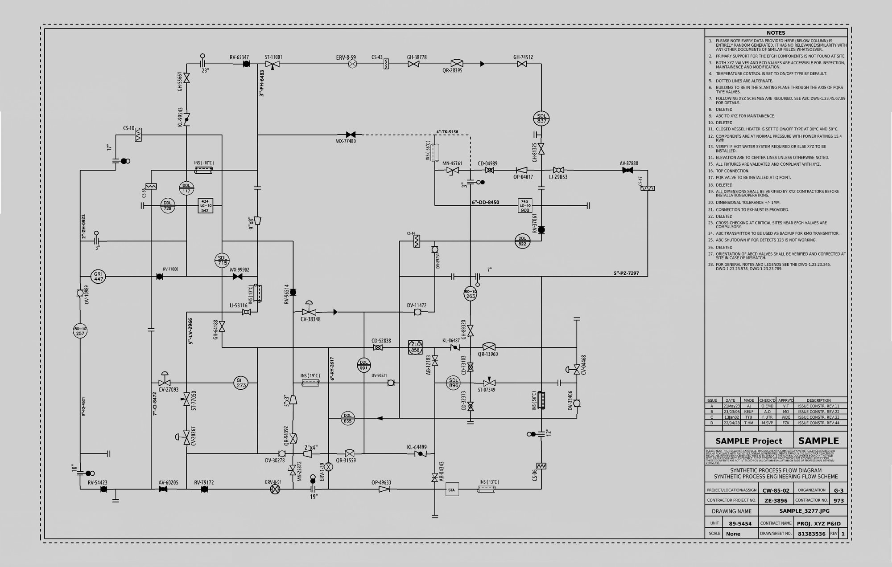
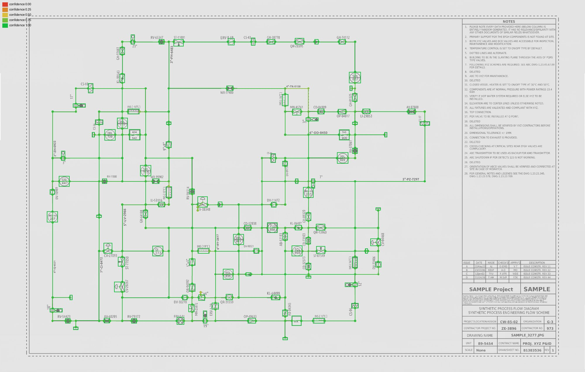

# P&ID Digitizer

Converts raster P&ID drawings (scans or rendered sheets) into a graph:
- **nodes:** symbols, plus line crossings and the ports where pipes enter symbols;
- **edges:** pipes and signal lines.

A Faster R-CNN model finds the symbols, working on the sheet in tiles. Lines are pulled out separately (horizontal and vertical only), after straightening the scan and cropping off the frame. The pieces are then joined into a graph, and every edge gets a confidence score calibrated against how often edges at that score turned out right. Output is GraphML ([schema](docs/GRAPHML_SCHEMA.md)) plus DEXPI-structured XML (DEXPI 2.0.1, [coverage](docs/DEXPI_COVERAGE.md)). I score it on [PID2Graph](https://zenodo.org/records/14803338) with the dataset's official graph metrics.

> **Status:** all six milestones in the [plan](docs/PROPOSAL.md) are done (pipeline, evaluation, exports, service, review UI, container). See [PROGRESS.md](PROGRESS.md).

## Example

One validation drawing processed by the service. All files are committed in [`examples/dataset_pid_10/`](examples/dataset_pid_10/), so you can inspect the output without running anything.

| Input drawing | Detected graph (colored by confidence) |
|---|---|
|  |  |

**Output:** [GraphML](examples/dataset_pid_10/result.graphml) with 410 nodes and 458 edges, and the same graph as [DEXPI 2.0.1 XML](examples/dataset_pid_10/result.dexpi.xml).

**On this sheet:** edge F1 0.909 and edge mAP 0.913 against the ground truth ([details](examples/dataset_pid_10/README.md)).

## Results (test splits, run once)

<!-- final:start -->
Final test results (run once; detector `weights/detector_m2c.pt` sha1 `531ab26ce150`, commit `7442fae`, config hash `23bb6984b356`). Splits are ours: PID2Graph releases no training data (DATASET_NOTES.md). Generated by `scripts/make_report.py`.

| test set | Symbols mAP@0.5 | Nodes AP@0.5 | Edge F1 | Edge mAP (PID2Graph protocol) | Edge F1 at degradation L1 / L2 / L3 |
|---|---|---|---|---|---|
| Dataset-PID (75 sheets) | 0.997 | 0.934 | 0.915 | 0.898 | 0.920 / 0.900 / 0.885 |
| Synthetic (38 sheets) | 0.991 | 0.934 | 0.915 | 0.918 | 0.897 / 0.881 / 0.837 |
| OPEN100 (real) (8 sheets) | 0.666 | 0.588 | 0.486 | 0.380 | 0.411 / 0.232 / 0.037 |
<!-- final:end -->

- **Full tables:** [docs/FINAL_RESULTS.md](docs/FINAL_RESULTS.md) covers per-class AP, error propagation, robustness ([figure](docs/robustness.png)), ablations, export validity, and published numbers for context.
- **Error analysis:** [docs/ERROR_ANALYSIS.md](docs/ERROR_ANALYSIS.md).
- **Experiment log:** [RESULTS.md](RESULTS.md).
- **Comparability:** these numbers are **not directly comparable** to the PID2Graph paper. Its training data is unreleased, so we train on parts of its test subsets, and our OPEN100 test has 8 sheets, not 12.

## Limitations

- **Domain gap:** two of the three test sets are generated, with clean renders and symbols drawn from a small template set, which is why symbol mAP is about 1.0 there. The only real drawings are 8 OPEN100 test sheets, plus 4 used in training. There, edge F1 is 0.49.
- **Coarse taxonomy:** 7 symbol classes, plus a catch-all `general` class. Pump has 0 AP on real sheets, with only 5 training instances.
- **Crossing convention:** every line crossing is treated as a connection (the generated subsets' convention). OPEN100 keeps crossings apart, so the pipeline over-connects real drawings. Junctions and pass-through crossings aren't distinguished.
- **Lines:** orthogonal only (no diagonals), no very short stubs, and no symbols nested inside other symbols.
- **Text:** not read. Tags and line numbers aren't extracted; text is only suppressed.
- **Robustness:** the simulator works in original-sheet pixels. On the small OPEN100 sheets (about 2 600 px wide), level 3 destroys the 2–3 px lines (edge F1 0.04). Generated sheets keep edge F1 ≥ 0.84 at level 3.
- **DEXPI:** topology-only and "DEXPI-structured", not certified. `general`, `arrow` and `inlet/outlet` aren't mapped, so 30–68% of symbols are represented.
- **Scoring tolerance:** with 8×8 structural nodes at IoU 0.5, 80% of the remaining Dataset-PID edge misses are nodes 2–4 px off, not topology errors ([analysis](docs/ERROR_ANALYSIS.md)).

## What I'd do next

- **Learn the crossing convention:** a junction-dot / line-hop classifier, needing a few labelled real sheets.
- **More real training data:** for pump, tank and the OPEN100 drawing style.
- **Port-aware node placement:** snap ankles to where the pipe's ink actually meets the symbol, rather than to the box edge.
- **Finer symbol classes:** for fuller DEXPI coverage.

## Quickstart (Docker, CPU)

```bash
python scripts/fetch_weights.py      # detector weights from the GitHub release (sha1-checked)
docker compose up --build            # http://localhost:8000: review UI; API docs at /docs
python scripts/demo.py               # upload the bundled sample drawing and print result URLs
```

`make demo` runs all three. The weights are the release asset [`weights-detector-m2c-v1`](https://github.com/Sent-hen/PID-Digitizer/releases/tag/weights-detector-m2c-v1). For a private repository, `fetch_weights.py` uses `GITHUB_TOKEN` or an authenticated `gh` CLI.

**Using the service:**
- Upload a PNG/JPEG/TIFF/BMP sheet in the UI, or run `curl -F file=@sheet.png localhost:8000/jobs`.
- Review the graph colored by confidence. Use the slider to show only low-confidence elements, click to inspect, and relabel, delete, confirm or add edges.
- Download **GraphML** or **DEXPI** XML.
- Corrections are saved immediately to an append-only log, and the original prediction stays available.

| endpoint | purpose |
|---|---|
| `POST /jobs` | upload an image (multipart `file`) → job id |
| `GET /jobs/{id}` | status and progress |
| `GET /jobs/{id}/result?format=graphml\|dexpi&version=current\|original` | download the graph |
| `GET /jobs/{id}/graph`, `PATCH /jobs/{id}/graph` | JSON graph and reviewer corrections |
| `GET /jobs/{id}/overlay` | PNG overlay colored by confidence |
| `GET /health` | liveness and model status |

## Dataset

PID2Graph (Stürmer, Graumann & Koch, IEEE DSAA 2025), CC BY-SA 4.0. Download it from Zenodo and unzip it so that `PID2Graph/Complete/...` sits at the repo root. Format, quirks and protocol are in [DATASET_NOTES.md](DATASET_NOTES.md).

## Reproduce

```bash
uv sync                                     # Python 3.11+, CUDA build of torch (cu132)
make check                                  # ruff, mypy --strict, CPU unit tests (CI)
uv run pytest -m dataset                    # tests that need PID2Graph on disk
uv run python scripts/make_splits.py        # splits/ (already committed)
make tiles && make train                    # detector, about 0.9-1.7 GPU-hours on an RTX 4070 Laptop
uv run python scripts/fit_confidence.py --split dataset_pid_val --split synthetic_val
make eval                                   # final test matrix (resumable) + all tables
make report                                 # tables/figures only, from saved metrics
make serve                                  # API + UI locally (GPU if available)
```

## License and attribution

- **Code:** to be decided. No AGPL dependencies are used; detector: torchvision, BSD-3.
- **Dataset and derived data:** the PID2Graph dataset, and derived files in `splits/` and `docs/` images, are CC BY-SA 4.0. They are © the PID2Graph authors and upstream sources (Dataset-P&ID by Paliwal et al.; OPEN100 by the Energy Impact Center; symbols by S. B. Sandoval).
- **DEXPI:** the schema and the derived vocabulary in `src/pid/export/dexpi_xsd/` are © DEXPI Initiative, CC BY 4.0.
