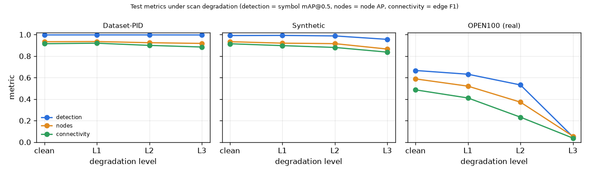

# Final results (Milestone 5)

Generated by `scripts/make_report.py` from `outputs/preds/*/metrics_*.json`; do not edit by hand. Run matrix: `configs/final_eval.yaml`.

- Detector: `weights/detector_m2c.pt` (sha1 `531ab26ce150`); pipeline commit `7442fae`, config hash `23bb6984b356`.
- Hardware: RTX 4070 Laptop 8 GB (thermally limited during these runs: timings are not comparable to earlier ones), Intel Core Ultra 9 185H, torch 2.14.1+cu132.
- Every test configuration was run exactly once; nothing was tuned on test.

## Headline (clean test sets)

| test set | n | Symbols mAP@0.5 | mAP@0.5:0.95 | Nodes AP@0.5 | Edge P / R / F1 | per-drawing F1 median / p10 | line-type acc | Edge mAP (solid / non-solid) |
|---|---|---|---|---|---|---|---|---|
| Dataset-PID | 75 | 0.997 | 0.945 | 0.934 | 0.915 / 0.915 / **0.915** | 0.931 / 0.848 | 0.980 | **0.898** (0.981 / 0.815) |
| Synthetic | 38 | 0.991 | 0.896 | 0.934 | 0.910 / 0.920 / **0.915** | 0.920 / 0.871 | 0.974 | **0.918** (0.937 / 0.898) |
| OPEN100 (real) | 8 | 0.666 | 0.507 | 0.588 | 0.610 / 0.404 / **0.486** | 0.477 / 0.375 | 0.999 | **0.380** (0.380 / –) |

## Per-class AP@0.5 (test)

| class | Dataset-PID | Synthetic | OPEN100 (real) |
|---|---|---|---|
| general | 0.988 | 0.990 | 0.744 |
| tank | – (absent) | 0.967 | 0.157 |
| valve | 1.000 | 0.998 | 0.860 |
| instrumentation | 1.000 | – (absent) | 0.969 |
| pump | – (absent) | 1.000 | 0.000 |
| arrow | 1.000 | 1.000 | 0.946 |
| inlet_outlet | – (absent) | – (absent) | 0.988 |

## Error propagation (oracle symbols vs detector)

| test set | Nodes AP oracle / predicted | Edge F1 oracle / predicted (gap) | Edge mAP oracle / predicted |
|---|---|---|---|
| Dataset-PID | 0.966 / 0.934 | 0.954 / 0.915 (-0.038) | 0.899 / 0.898 |
| Synthetic | 0.986 / 0.934 | 0.980 / 0.915 (-0.065) | 0.925 / 0.918 |
| OPEN100 (real) | 0.649 / 0.588 | 0.594 / 0.486 (-0.107) | 0.430 / 0.380 |

## Robustness (degradation simulator, configs/degrade.yaml)

Stage metrics: detection = symbol mAP@0.5, nodes = node AP@0.5, connectivity = edge F1. 

| test set | level | Symbols mAP@0.5 | Nodes AP | Edge F1 | Edge mAP |
|---|---|---|---|---|---|
| Dataset-PID | clean | 0.997 | 0.934 | 0.915 | 0.898 |
| Dataset-PID | L1 | 0.997 | 0.935 | 0.920 | 0.891 |
| Dataset-PID | L2 | 0.997 | 0.924 | 0.900 | 0.866 |
| Dataset-PID | L3 | 0.997 | 0.918 | 0.885 | 0.837 |
| Synthetic | clean | 0.991 | 0.934 | 0.915 | 0.918 |
| Synthetic | L1 | 0.992 | 0.920 | 0.897 | 0.912 |
| Synthetic | L2 | 0.988 | 0.916 | 0.881 | 0.894 |
| Synthetic | L3 | 0.956 | 0.865 | 0.837 | 0.780 |
| OPEN100 (real) | clean | 0.666 | 0.588 | 0.486 | 0.380 |
| OPEN100 (real) | L1 | 0.632 | 0.521 | 0.411 | 0.305 |
| OPEN100 (real) | L2 | 0.532 | 0.372 | 0.232 | 0.160 |
| OPEN100 (real) | L3 | 0.050 | 0.055 | 0.037 | 0.047 |

## Ablations (one decision switched off; Δ vs the final configuration)

| ablation | test set | Edge F1 (Δ) | Edge mAP (Δ) | Nodes AP (Δ) |
|---|---|---|---|---|
| crop off | Dataset-PID | 0.913 (-0.002) | 0.896 (-0.002) | 0.932 (-0.001) |
| crop off | Synthetic | 0.915 (+0.000) | 0.918 (+0.000) | 0.934 (+0.000) |
| crop off | OPEN100 (real) | 0.442 (-0.044) | 0.349 (-0.032) | 0.577 (-0.011) |
| ankle-port rule off | Dataset-PID | 0.901 (-0.014) | 0.893 (-0.005) | 0.928 (-0.006) |
| ankle-port rule off | Synthetic | 0.914 (-0.001) | 0.917 (-0.000) | 0.933 (-0.001) |
| ankle-port rule off | OPEN100 (real) | 0.503 (+0.017) | 0.402 (+0.021) | 0.606 (+0.018) |
| dashed join tolerance off | Dataset-PID | 0.915 (+0.000) | 0.856 (-0.041) | 0.934 (+0.000) |
| dashed join tolerance off | Synthetic | 0.915 (+0.001) | 0.919 (+0.001) | 0.934 (+0.000) |
| dashed join tolerance off | OPEN100 (real) | 0.493 (+0.007) | 0.382 (+0.002) | 0.589 (+0.000) |
| confidence model off (all scores 1.0) | Dataset-PID | 0.915 (+0.000) | 0.751 (-0.146) | 0.902 (-0.032) |
| confidence model off (all scores 1.0) | Synthetic | 0.915 (+0.000) | 0.906 (-0.012) | 0.925 (-0.009) |
| confidence model off (all scores 1.0) | OPEN100 (real) | 0.486 (+0.000) | 0.355 (-0.025) | 0.513 (-0.075) |
| deskew off (at degradation L2) | Dataset-PID | 0.476 (-0.423) | 0.493 (-0.373) | 0.591 (-0.334) |
| deskew off (at degradation L2) | Synthetic | 0.453 (-0.427) | 0.516 (-0.378) | 0.494 (-0.422) |
| deskew off (at degradation L2) | OPEN100 (real) | 0.162 (-0.070) | 0.117 (-0.043) | 0.312 (-0.060) |

OPEN100 oversampling ablation: RESULTS R-003 (same 8 OPEN100 test sheets, symbol mAP 0.397 without OPEN100 training sheets vs 0.704 with).

## Export validity (final test predictions)

| test set | GraphML invalid | DEXPI invalid | symbols mapped to DEXPI | unmapped |
|---|---|---|---|---|
| Dataset-PID | 0/75 | 0/75 | 6047 | arrow 273, general 2657 |
| Synthetic | 0/38 | 0/38 | 299 | arrow 15, general 628 |
| OPEN100 (real) | 0/8 | 0/8 | 520 | arrow 320, general 216, inlet_outlet 82 |

## Context: published numbers (not comparable)

Stürmer et al. (2025) Table III, stitched. Different, unreleased training data and full-subset test sets; their Dataset-P&ID edges are single-class. Shown for scale only.

| method | test set | Symbols mAP | Nodes AP | Edge mAP |
|---|---|---|---|---|
| Modular Digitization (paper) | OPEN100 (12) | 76.99 | 52.14 | 45.89 |
| Relationformer (paper) | OPEN100 (12) | 73.14 | 83.63 | 75.46 |
| this work | OPEN100 (8) | 66.63 | 58.82 | 38.05 |
